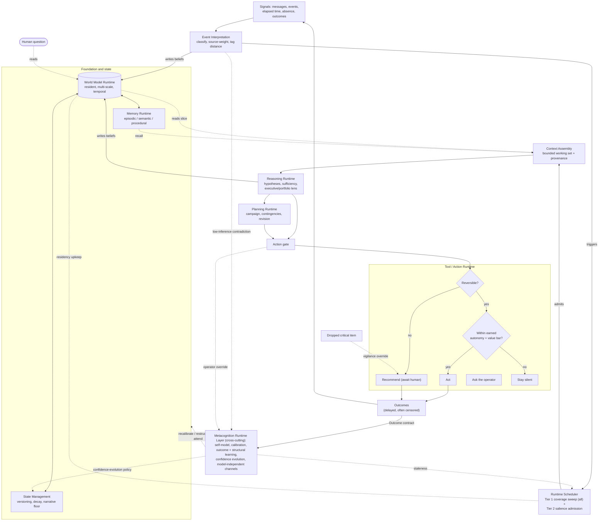

# The SocialCRM AI Runtime Architecture (v1.1 — ratified)

> How the ratified cognition is **made to run**. Not what the mind is (that is the [Constitution](./intelligence-constitution.md)), not what its thoughts are made of (that is the [Theory of Intelligence](./theory-of-intelligence.md)), not how the mind thinks (that is the [Cognitive Architecture](./cognitive-architecture.md)), and not which technology builds it (that is [`ai-architecture.md`](./ai-architecture.md)). This document defines the **runtime systems** that realize the cognition faithfully, and adds nothing to it.

---

| Field      | Value                                                                                                                                                                                                                                                                                                                                                                                                                                                                                                                                                                                                                                                                                                               |
| ---------- | ------------------------------------------------------------------------------------------------------------------------------------------------------------------------------------------------------------------------------------------------------------------------------------------------------------------------------------------------------------------------------------------------------------------------------------------------------------------------------------------------------------------------------------------------------------------------------------------------------------------------------------------------------------------------------------------------------------------- |
| Version    | 1.1                                                                                                                                                                                                                                                                                                                                                                                                                                                                                                                                                                                                                                                                                                                 |
| Status     | **Ratified & FROZEN at v1.1 (2026-07-13)** — the current canonical runtime layer for SocialCRM Intelligence; governed by the Constitution; **realizes** the ratified Cognitive Architecture v2.1; conformant to the frozen Theory of Intelligence v1.1                                                                                                                                                                                                                                                                                                                                                                                                                                                              |
| Scope      | Runtime architecture only. **Technology-independent.** No implementation, code, prompts, models, tools, storage, interfaces, frameworks, evaluation metrics, or roadmap.                                                                                                                                                                                                                                                                                                                                                                                                                                                                                                                                            |
| Governs    | How the ratified cognition is realized as runtime systems: the contracts, boundaries, data flow, and invariant enforcement every implementation must honor.                                                                                                                                                                                                                                                                                                                                                                                                                                                                                                                                                         |
| Realizes   | [`cognitive-architecture.md`](./cognitive-architecture.md) (v2.1, ratified and frozen) — WHAT the mind is; this document is HOW it runs. It **references** cognitive capabilities and never re-defines them.                                                                                                                                                                                                                                                                                                                                                                                                                                                                                                        |
| Built on   | [`intelligence-constitution.md`](./intelligence-constitution.md) (supreme), [`theory-of-intelligence.md`](./theory-of-intelligence.md) (frozen), [`cognitive-architecture.md`](./cognitive-architecture.md) (ratified).                                                                                                                                                                                                                                                                                                                                                                                                                                                                                             |
| Below it   | [`ai-architecture.md`](./ai-architecture.md) — the technology-specific code and infrastructure doctrine that **implements** this runtime architecture.                                                                                                                                                                                                                                                                                                                                                                                                                                                                                                                                                              |
| Revisions  | v1.1 — resolves adversarial-review C1 by adding a cross-cutting **Metacognition Runtime Layer** (Part 3A) that owns the self-model, calibration, outcome and structural learning, confidence evolution, and the model-independent correction channels — **without** adding a tenth runtime system; adds the Prediction, Observation, Outcome, and Calibration contracts (M14); and resolves M1 (sole reversibility authority), M5 (standards enforced structurally as seams), M6 (coverage as membership, not simultaneity), M7 (egress groundedness check), M8 (substrate-failure behavior), and F2 (vigilance on Tier 1 low-inference signals). No new runtime system, no new philosophy, no cognition redefined. |
| Mutability | Frozen. The runtime architecture is stable; it changes only through a deliberate, versioned revision that stays runtime-level, technology-neutral, must not re-define cognition, and must not alter any upstream doctrine. The accepted future refinements (Part 12) are candidates for a later revision, not silent edits.                                                                                                                                                                                                                                                                                                                                                                                                                                                                                                                                                                       |

> **Freeze note.** This document is the ratified, frozen runtime layer. It defines _how the ratified cognition is made to run_ and nothing else. The next phase — **implementation** ([`ai-architecture.md`](./ai-architecture.md)) — must _implement_ this runtime architecture, never modify it; where the two ever disagree, the implementation is wrong until reconciled (Constitution Article 0.4).

> **One-line thesis.** The mind defined by the Cognitive Architecture is made to _run_ by **nine runtime systems** bound by explicit **contracts** and **boundaries**, carrying beliefs through a single continuous **data flow**, watched across all of them by a cross-cutting **Metacognition Runtime Layer**, with the Constitution's inviolable principles enforced structurally by a **safety spine** — realizing the cognition faithfully and adding nothing to it.

### What this document is, and is not

- It **is** the runtime layer: the systems, contracts, boundaries, flow, and enforcement that make the ratified cognition operate. It is technology-neutral.
- It is **not** the Cognitive Architecture. It never re-defines, re-decomposes, or re-explains a mind-part; it names the runtime that _realizes_ one and points to it. If a passage here explains what a capability _is_ rather than _how it runs_, it has drifted up a layer and is wrong.
- It is **not** the implementation ([`ai-architecture.md`](./ai-architecture.md)), which chooses concrete technology beneath it. If a passage here names a technology, mechanism, model, prompt, store, or interface, it has drifted down a layer and is wrong.
- It is **governed by** the Constitution (Article 0.1), **realizes** the ratified Cognitive Architecture, and is **conformant to** the frozen Theory. On any conflict, the upstream doctrine wins and this document is corrected — never the reverse — and the conflict is resolved explicitly, never left as silent divergence (Constitution Article 0.4). Part 11 makes conformance auditable.

---

## Part 0 — Governance and the fidelity principle

This layer exists to do exactly one thing: **realize the ratified cognition, faithfully and completely, and add nothing to it.** Three rules make that binding.

1. **Reference, never redefine.** Every cognitive capability (World Model, Attention, Reasoning, Planning, Action Gate, and the rest) is defined once, upstream, and is frozen. This document points to each by name and builds a runtime for it. It may not restate what a capability is, improve it, or extend it.
2. **Faithful realization.** Each runtime system must be able to produce every behavior the cognition specifies, and must make impossible every behavior the cognition forbids. A runtime that merely _permits_ correct behavior is insufficient; the inviolable principles must be structurally enforced (Part 7), not left to good conduct.
3. **Conflict resolution, one direction only.** If a runtime system cannot realize a cognitive requirement, the **runtime document is wrong** and is corrected; the cognition is not bent to fit the machine. Silent divergence — the runtime quietly doing something the cognition does not sanction — is itself a violation (Constitution Article 0.4).

**The supremacy chain:** Constitution → Theory of Intelligence → Cognitive Architecture → **this document** → implementation. Each layer conforms to the one above and constrains the one below.

_Implements:_ Constitution Article 0 (0.1, 0.3, 0.4); Cognitive Architecture freeze note and Part 0.

---

## Part 1 — Operational reality (the runtime forces)

Before naming the systems, we fix the forces of the environment they must _run_ in. These are distinct from the cognitive environment (Cognitive Architecture Part 1, which fixed the _world the mind reasons about_); these are the _conditions the machine must operate under_. Each is stated with the runtime commitment it forces.

1. **Residency is an operational obligation, not only a philosophy.** The world model must persist and stay live between activations. _Forces:_ a runtime that maintains standing state across time, not one summoned by a question. (Constitution I.1; Cognitive Architecture B, C.)
2. **Inputs arrive asynchronously, out of order, and include the passage of time.** A message, an event, and "nothing happened for nine days" are all inputs. _Forces:_ an ingress that treats elapsed time and absence as first-class signals, not only received messages. (Cognitive Architecture Part 1.3, C; Theory §3.3, §3.22.)
3. **Multiple operators act concurrently under distinct permission scopes.** _Forces:_ every runtime read and write is scoped to actor and role, and no operator's state crosses into another's. (Constitution VII.5; Cognitive Architecture K.)
4. **Any runtime system can fail partially.** _Forces:_ the whole degrades to honest reduced capability, never to fabrication or a silently dropped ball. (Constitution XI.1, XI.4; Cognitive Architecture Part 1.12.)
5. **State is large and grows; not all of it can be brought to bear at once.** _Forces:_ a bounded working set assembled per reasoning episode, and a cheap pass that can still cover everything shallowly. (Cognitive Architecture D, Part 1.10, Part 1.12.)
6. **Cost and latency are finite and real — but may bend only depth, never coverage or the standards.** _Forces:_ degradation that shrinks reasoning depth while holding the coverage floor and every honesty standard identical. (Cognitive Architecture Part 1.12; Constitution VIII, IX, XI.)
7. **The outside world is effectful and partly irreversible.** _Forces:_ a single gated boundary to the world, across which irreversible effects are never taken autonomously. (Constitution VII.3, XI.2; Cognitive Architecture J.)
8. **Outcomes are delayed and often censored.** _Forces:_ the runtime records what it did and observes what returns, without imputing outcomes that never arrive. (Cognitive Architecture G; Theory §3.27, Law 15.)

_Implements:_ Constitution I.1, VII.3, VII.5, VIII, IX, XI; Theory §3.3, §3.22, §3.27, Law 15; Cognitive Architecture Part 1, B, C, D, G, J.

---

## Part 2 — The realization map (WHAT becomes HOW)

This is the binding between the ratified cognition and the runtime systems that realize it. It is a **map, not a decomposition**: the mind was already decomposed, upstream. The mapping is deliberately **many-to-many** — some capabilities are realized by several systems, and some systems serve several capabilities — and that is expected.

- **World Model** (Cog B) → **World Model Runtime**, with **State Management** (its lifecycle) and **Memory Runtime** (its recall services).
- **Triggers + perception → belief** (Cog C, E) → **Event Interpretation**.
- **Attention controller + the continuous loop** (Cog C, D) → **Runtime Scheduler**, feeding **Context Assembly** (which materializes the attended region).
- **Comprehension, hypotheses, sufficiency, executive/portfolio reasoning** (Cog E, F, H, L) → **Reasoning Runtime**.
- **Planning faculty** (Cog I) → **Planning Runtime**.
- **Action Gate and the four outputs** (Cog J, M) → **Tool / Action Runtime**.
- **Metacognition, the self-model, learning, forgetting** (Cog G; and the self-monitoring that rides above the loop) → owned by the cross-cutting **Metacognition Runtime Layer** (Part 3A), which _spans_ the nine: it hosts decay and forgetting in **State Management**, consolidation in **Memory Runtime**, belief update in **Reasoning Runtime**, and staleness re-attention in the **Runtime Scheduler**, while itself owning the self-model, calibration, outcome and structural learning, and confidence-evolution policy. It is a **layer, not a tenth runtime system**.
- **Theory of mind, operator model, earned autonomy** (Cog K) → represented in **World Model Runtime** and **Memory Runtime**, consumed by **Reasoning Runtime** and enforced at the **Tool / Action Runtime** gate.

**The reading rule for the whole document:** each system section below says what cognitive capability it _realizes_ (by pointer) and then describes only the runtime concerns of realizing it. It does not restate the capability.

_Implements:_ Cognitive Architecture Parts A–M (referenced, not restated); Constitution XII.

---

## Part 3 — The nine runtime systems

Each system is described as: **Realizes** (the cognitive capability, by pointer) · **Runtime responsibility** · **Key runtime concerns** · **Must not** · **Implements**.

### 3.1 World Model Runtime

- **Realizes:** the standing World Model (Cog B).
- **Runtime responsibility:** hold the resident, multi-scale, temporal model as live state that persists between activations and is addressable at both relationship scale and portfolio scale; serve a question as a _read_ against it and an event as a _write_ to it, without being summoned into existence by either.
- **Key runtime concerns:** identity and addressing of relationships and portfolio aggregates; residency across activations; presenting many scales over one substrate; exposing graded beliefs rather than bare facts.
- **Must not:** define what a belief or the model _contains_ (that is the Contracts of Part 4 and the Theory); choose any storage or representation mechanism (implementation).
- **Implements:** Constitution I.1, V, VI.1; Cognitive Architecture B; Theory §3.10, §3.23.

### 3.2 State Management

- **Realizes:** the temporality and continuity of belief (Cog B temporal property; Cog G forgetting and continuity).
- **Runtime responsibility:** own the _lifecycle_ of model state — versioning, consistency under concurrent writes, staleness marking, and the partitioned forgetting whose relationship-narrative floor (history, promises, outcomes) is never pruned or consolidated away. It **executes** confidence decay with un-refreshed time, but does so under the confidence-evolution _policy_ owned by the Metacognition Runtime Layer (Part 3A), so decay and learning can never silently disagree.
- **Key runtime concerns:** temporal semantics (as-of time, trajectory); resolving concurrent updates from multiple operators; decay and staleness as a policy _seam_ (not concrete rates); the guaranteed narrative floor.
- **Must not:** decide what a belief means; choose persistence mechanism or set concrete decay values (implementation policy within the seam).
- **Implements:** Constitution I.1, III.2, XI.7; Cognitive Architecture B, G; Theory §3.11, §3.12, §3.22, §3.23, Law 10.

### 3.3 Memory Runtime

- **Realizes:** episodic, semantic, and procedural memory (Cog G).
- **Runtime responsibility:** retain specific cases (episodic), consolidated base rates (semantic), and retained know-how (procedural) as _distinct_ runtime services, and make them recallable to support recognition and priors — kept separate from the live world model.
- **Key runtime concerns:** consolidation of episodes into base rates; recall that enables recognising a new situation as _like_ a known one; provenance of remembered items.
- **Must not:** reduce memory to priors alone (which would make case-based recognition impossible); choose indexing or retrieval technology.
- **Implements:** Constitution III.2; Cognitive Architecture G; Theory §3.11.

### 3.4 Event Interpretation

- **Realizes:** the endogenous triggers and the perception-to-belief step (Cog C, E).
- **Runtime responsibility:** the loop's ingress — accept incoming traces and elapsed-time signals, classify them, weight them by source reliability, detect _absence_ (the reply that never came, the passed deadline), and emit belief updates tagged with inferential distance and provenance, along with the surprise signal against what the model expected.
- **Key runtime concerns:** time and absence as first-class inputs; source weighting before a belief moves; production of the surprise signal; carrying the inferential-distance tag from the very first touch.
- **Must not:** assert an unobserved fact as observed (the fabrication ban is enforced here, at ingress); interpret beyond the inferential-distance discipline; choose an ingestion mechanism.
- **Implements:** Constitution XI.1, IX.5, XII; Cognitive Architecture C, E; Theory §3.3, §3.4, §3.22.

### 3.5 Context Assembly

- **Realizes:** the runtime materialization of the attended region for a reasoning episode (consequence of Cog D admission; the working set Cog E operates on).
- **Runtime responsibility:** assemble the bounded working set a reasoning episode operates on — the relevant slice of the world model plus memory plus the modelled other-minds — carrying provenance and inferential-distance tags through intact, so the Reasoning Runtime sees exactly what should be brought to bear and no more.
- **Key runtime concerns:** relevance selection under a bounded budget; provenance carry-through; keeping the Tier 1 coverage pass cheap (it needs only minimal assembly); never silently dropping disconfirming evidence from the working set.
- **Must not:** decide _what earns cognition_ (that is the Scheduler); choose retrieval or selection technology.
- **Implements:** Constitution VIII, XI.3, XI.8; Cognitive Architecture D, E; Theory §3.5, §3.13.

### 3.6 Runtime Scheduler

- **Realizes:** the attention controller and the continuous loop (Cog C, D).
- **Runtime responsibility:** the control heartbeat — run **Tier 1** pre-attentive coverage sweeps over _every_ live relationship on cadence, admit **Tier 2** salient candidates for deep processing, arbitrate the two attention economies (the mind's own and the operator's), and keep the model resident through time-driven and event-driven activation. It also raises the self-model's staleness re-attention.
- **Key runtime concerns:** guaranteeing coverage as _membership, not instantaneous simultaneity_ — every live relationship stays in the swept set on a cadence fast enough to detect a time-critical change before it becomes critical; under load the sweep _cadence_ may lengthen, but no live relationship is ever dropped from the swept set and no time-critical threshold is disarmed; salience-based admission of the few; separation of the two economies; residency upkeep; scheduling re-attention on stale regions.
- **Must not:** perform portfolio triage — the comparative economic ranking across the admitted set is the executive lens inside the Reasoning Runtime (the detection/comparison split of Cog D vs H); choose a scheduling mechanism.
- **Implements:** Constitution VI.4, VII.1, XI.4, XII; Cognitive Architecture C, D; Theory §3.13, §3.22, Law 6.

### 3.7 Reasoning Runtime

- **Realizes:** comprehension, competing hypotheses, sufficiency, and executive/portfolio reasoning (Cog E, F, H, L).
- **Runtime responsibility:** execute a _bounded_ reasoning episode on an assembled context to decision-stability — maintain competing hypotheses scored by disconfirmation, name the cheapest discriminating observation while any remain live, apply the lens the Scheduler admitted (including the executive lens's comparative portfolio triage across the admitted set), produce calibrated beliefs and mark structurally-uncalibratable ones, and stop at sufficiency scaled by stakes.
- **Key runtime concerns:** the hypothesis lifecycle; diagnosticity-driven choice of what to investigate next; the sufficiency (decision-stability) test; portfolio triage as a lens, not as scheduling; emitting the calibratable/uncalibratable status on every belief.
- **Must not:** define what understanding or sufficiency _are_ (Cog F); cross the action boundary itself (that is the gate); choose a model, prompt, or reasoning technology.
- **Implements:** Constitution V, VI, IX, X, XI.3; Cognitive Architecture E, F, H, L; Theory §3.5, §3.7, §3.9, §3.19, §3.27, Laws 2, 4, 16.

### 3.8 Planning Runtime

- **Realizes:** the planning faculty (Cog I).
- **Runtime responsibility:** construct, hold, and revise multi-step campaigns toward a next commitment as runtime processes that persist across cycles and update as the world responds — a plan held as a hypothesis about the future, with contingencies, revised (not clung to) when the world contradicts it.
- **Key runtime concerns:** persistence of plan state across activations; contingency branches; revision triggered by contradicting evidence; counting the plan's operator-attention cost as part of its evaluation.
- **Must not:** execute an irreversible step autonomously (that routes through the gate); choose a planning algorithm.
- **Implements:** Constitution X; Cognitive Architecture I; Theory §3.16, §3.24, §3.25, §3.26, Law 13.

### 3.9 Tool / Action Runtime

- **Realizes:** the action gate and its four outputs (Cog J, M).
- **Runtime responsibility:** the effector layer — carry out reversible actions that are within earned autonomy and clear the value bar; route irreversible ones (or those beyond earned autonomy) to human authorization as recommendations; apply the value and taste checkpoint before spending any operator attention; honor the mandatory vigilance override for a genuinely dropped critical item; and record every action so its outcome can feed back.
- **Key runtime concerns:** reversibility classification at the point of execution — this gate is the **sole authority** that decides reversibility; the Action-descriptor's reversibility field (Part 4) is an advisory planning hint the gate re-checks and may override, never a decision the gate inherits; the earned-autonomy check against the represented belief (Part 4); realizing the four terminal outputs — act, recommend, ask, stay silent; a final **groundedness check at the output boundary** — nothing is surfaced or sent unless every claim in it walks back to traces (Part 4 provenance contract), so fabrication is blocked at egress as well as at ingress; provenance of every action; emitting the Outcome contract (Part 4) back to Event Interpretation and the Metacognition Runtime Layer.
- **Must not:** relocate the irreversible boundary (it is permanent, VII.3); take an irreversible effect without an explicit human hand; choose action mechanisms or integrations (implementation).
- **Implements:** Constitution VII.1, VII.2, VII.3, XI.2, XI.4, XI.5, XI.6, XIII; Cognitive Architecture J, M; Theory §3.15, §3.25, Law 12.

---

## Part 3A — The Metacognition Runtime Layer (cross-cutting; not a tenth runtime system)

Metacognition (Cog G) — together with the self-monitoring that in the Cognitive Architecture rides _above_ the loop, watching the cycle's own errors — is **not a stage in the loop and must not become one.** Like the safety spine (Part 7), it is a **cross-cutting layer**, not a tenth runtime system: it owns definite state and definite responsibilities, but it **executes by attaching to the nine systems**, never by standing beside them as another loop stage. This layer is the single named **owner** of the mind's model of itself; the nine systems host its effects.

**What it owns — and where each effect is hosted in the nine:**

- **The self-model.** The mind's standing representation of its own reliability, blind spots, and staleness. Owned here as first-class runtime state; its _persistence_ is hosted by State Management, but its _meaning and evolution_ are owned by this layer, not by any single system. (Cognitive Architecture G; Theory §3.21, Law 11.)
- **Calibration.** The standing mapping of stated confidence to observed frequency, by region of the model. This layer aggregates resolved outcomes into calibration and writes the correction back into the belief contract's groundedness status. (Constitution IX, XI.3; Theory §3.8, §3.21, Law 5.)
- **Outcome learning.** Consuming the Outcome contract (Part 4), it updates the self-model and calibration from what predictions actually resolved to — and never imputes an outcome that never arrived; censored predictions stay censored and widen uncertainty rather than reading silence as confirmation. (Cognitive Architecture G; Theory §3.27, Law 15.)
- **Structural learning.** When one-directional surprise accumulates past a threshold, this layer owns the _judgement_ that a category or relationship model is mis-shaped and must be re-carved; the World Model Runtime _hosts_ the restructuring, but the trigger and the decision to restructure are owned here. (Cognitive Architecture G; Theory §3.18, Law 10.)
- **Confidence evolution.** The _policy_ by which confidences move over time and evidence — decay when un-refreshed, correction under calibration. State Management _executes_ the decay mechanics; the policy of how confidence should evolve is owned here, so decay and learning can never silently disagree. (Cognitive Architecture G; Theory §3.12, §3.21.)
- **Model-independent correction channels.** At least one always-live channel that does **not** derive from the model's own predictions, so a drifted model cannot confidently police its own drift and go blind. This layer owns the three the cognition requires: **staleness** (elapsed time, read from State Management and the Scheduler), **direct low-inference contradiction** (a bottom-of-gradient trace from Event Interpretation that a belief cannot survive), and **operator override** (a human correction crossing the Tool / Action Runtime and the Operator boundary). The staleness channel is guaranteed live at all times, because the passage of time is always observable. (Cognitive Architecture G; Constitution III.6, VII.2, XI.3; Theory §3.21, Law 11.)

**How it spans the loop.** It _reads_ the Prediction, Observation, Outcome, and Calibration contracts (Part 4); it _writes_ corrections into the belief contract's groundedness status and into the self-model; it _triggers_ re-attention through the Runtime Scheduler (staleness), restructuring through the World Model Runtime, and confidence-evolution policy through State Management. It never assembles a working set, never reasons a business conclusion, and never crosses the action boundary — those remain the nine systems'.

**Must not:** define what the self-model, calibration, or learning _are_ (that is Cog G and the Theory); become a stage in the data flow or a tenth runtime system; reason about the business or take an action; choose any mechanism, model, or store (implementation).

**Implements:** Constitution III.6, VII.2, VIII, IX, XI.1, XI.3; Cognitive Architecture G, and the self-monitoring that rides above the loop; Theory §3.11, §3.12, §3.18, §3.21, §3.27, Laws 10, 11, 15.

---

## Part 4 — Runtime Contracts

The systems agree on a small set of **logical shapes** that cross between them. These are contracts, not schemas: they say _what must be carried_, never _how it is stored or serialized_.

- **Belief contract** — content, confidence, evidence for _and against_, freshness, and groundedness (including the earned-calibratable vs. structurally-uncalibratable status). A claim that cannot carry its evidence or state its confidence is not a belief and may not enter the model. (Theory §3.6; Cognitive Architecture B, E.)
- **Uncertainty contract** — the two kinds (epistemic vs. aleatoric) and the two orders (the credence, and how well-grounded it is). (Theory §3.7, §3.8.)
- **Provenance and inferential-distance contract** — every claim carries how far it sits from the trace and can be walked back down to the traces beneath it; high-inference claims are never presented as low-inference. (Cognitive Architecture E; Constitution XI.1, XI.8.)
- **Signal contract** — a typed trace with source reliability, absence markers, and the surprise it produced. (Cognitive Architecture C, E; Theory §3.3.)
- **Temporal contract** — as-of time, trajectory, and decay/staleness marks travel with state. (Theory §3.22; Cognitive Architecture B.)
- **Action-descriptor contract** — the causal-effect claim, the reversibility class, the autonomy requirement, and the expected value net of cost. (Cognitive Architecture I, J; Theory §3.24, §3.25, §3.26.)
- **Earned-autonomy contract** — a graded, revisable belief held per operator and per class of action, read by the gate. (Cognitive Architecture K; Constitution VIII.5.)
- **Plan contract** — a campaign with its next commitment, contingencies, and confidence, revisable as the world responds. (Cognitive Architecture I; Theory §3.16.)

The next four are the **metacognition contracts** — the shapes the Metacognition Runtime Layer (Part 3A) reads and writes so that the self-model, calibration, and learning rest on data that actually exists.

- **Prediction contract** — a commitment the model made about what should happen and by when, carrying the confidence attached, so that surprise and calibration can later be computed against it. A confidence with no prediction it answers for is unaccountable and cannot be calibrated. (Cognitive Architecture G; Theory §3.8, §3.21.)
- **Observation contract** — a trace considered against one or more live hypotheses: what was seen (or the absence that was noticed), its source reliability, its as-of time, and its inferential distance. This is the evidential form a Signal takes when it bears on a belief; it is what lets disconfirming evidence be first-class rather than dropped. (Cognitive Architecture E; Theory §3.3, §3.4, §3.5.)
- **Outcome contract** — what a prediction actually resolved to, **or** an explicit _censored / unresolved_ marker when it never did; delay and ambiguity are represented, and an outcome is **never imputed**. Emitted by the Tool / Action Runtime and Event Interpretation; consumed by the Metacognition Runtime Layer. (Cognitive Architecture G; Theory §3.27, Law 15.)
- **Calibration contract** — the standing aggregate mapping stated confidence to observed frequency, by region of the model, carrying its sample size and its censored fraction so a region's calibration is never read as more settled than the resolved evidence allows. (Constitution IX, XI.3; Theory §3.8, §3.21, Law 5.)

Implementation binds concrete forms to each contract but may not add to, drop from, or weaken them.

_Implements:_ Constitution VIII.5, IX, XI.1, XI.3, XI.8; Cognitive Architecture B, E, G, I, J, K; Theory §3.3–§3.8, §3.16, §3.21, §3.22, §3.24, §3.25, §3.26, §3.27, Law 15.

---

## Part 5 — Runtime Boundaries

Five boundaries structure the runtime. Each names what may cross it and where the crossing is checked.

1. **Cognition ↔ Runtime (fidelity).** The runtime realizes cognition; nothing new is added. _Crossing:_ cognitive requirements flow down; a runtime that cannot meet one is corrected. _Checkpoint:_ the conformance map (Part 11) and adversarial review.
2. **Runtime ↔ Implementation.** Logical contracts and boundaries flow down; concrete technology may be chosen freely beneath them but may not alter a contract or an observable behavior. _Checkpoint:_ contract conformance (Part 4).
3. **Mind ↔ Operator.** Perception, memory, and vigilance are the mind's; goals and irreversible acts are the human's. The mind may only act (within reversible earned autonomy), recommend, ask, or stay silent. _Checkpoint:_ the Tool / Action Runtime gate (3.9).
4. **Mind ↔ Outside world (the permanent irreversible line).** Only recommendations cross it toward irreversible effect; autonomy grows without limit only _inside_ the reversible domain; the line never moves. _Checkpoint:_ reversibility classification in the Tool / Action Runtime, which is the **sole authority** on reversibility at execution — no upstream descriptor, plan, or rising confidence can pre-authorize a crossing.
5. **Operator ↔ Operator (permission scoping).** Goals, memory, and relationship ownership are scoped to actor and role, and never cross between operators. _Checkpoint:_ scoping in Context Assembly and the World Model Runtime, enforced as a boundary.

_Implements:_ Constitution Article 0, VII.1, VII.2, VII.3, VII.5, XI.2; Cognitive Architecture J, K.

---

## Part 6 — Runtime Data Flow

The nine systems realize a single continuous loop. Signals become beliefs, beliefs become understanding and priorities, priorities become candidate actions, and outcomes feed back — while a question is only an occasional _read_ of the standing model. Metacognition rides above the loop.

The claims of the flow: the world model is resident and only _read_ by a question; the ingress turns traces, time, and absence into tagged beliefs; the Scheduler guarantees coverage over all and admits the few; Context Assembly bounds what a reasoning episode sees; reasoning writes beliefs back and hands priorities to planning or straight to the gate; every output passes the reversibility and value gate; outcomes re-enter as signals; and the cross-cutting Metacognition Runtime Layer rides above, recalibrating, restructuring, and re-attending under censored outcomes. The runtime is a cycle, not a conveyor belt.

_Implements:_ Constitution XII; Cognitive Architecture A, C–M, Part 3; Theory Part 8.

---

## Part 7 — Invariant enforcement across the runtime (the safety spine)

The inviolable principles must be _structurally guaranteed_, not merely permitted. No single system owns safety; each invariant has a named enforcing seam.

- **Never fabricate; reasoning is auditable.** Enforced at Event Interpretation (ingress tagging), the provenance contract (Part 4), the Reasoning Runtime (inferential-distance discipline), a **groundedness check at the Tool / Action Runtime output boundary (egress)**, and Observability (Part 9). Fabrication is blocked at both the entrance and the exit, not only where beliefs are formed. (Constitution XI.1, XI.8.)
- **Never cross the irreversible line autonomously.** Enforced solely at the Tool / Action Runtime reversibility classification, which is the sole authority on reversibility; the line is permanent. (Constitution VII.3, XI.2.)
- **Calibration honesty where earnable; uncalibratable beliefs marked.** Enforced by the belief contract's groundedness status, the Reasoning Runtime, and the Metacognition Runtime Layer's calibration under censored outcomes. (Constitution IX, XI.3.)
- **The mind knows its own reliability.** The self-model, calibration, learning, and the model-independent correction channels are owned by the Metacognition Runtime Layer (Part 3A); at least one correction channel — **staleness** — is always live because the passage of time is always observable, so a drifted model can never fully police itself. (Constitution IX, XI.3; Cognitive Architecture G.)
- **Never drop a ball silently.** Enforced by the Runtime Scheduler's Tier 1 coverage floor (every live relationship stays in the swept set on a criticality-beating cadence — membership never shrinks, though cadence may stretch) and the Tool / Action Runtime vigilance override. (Constitution VI.4, XI.4.)
- **Never noisy.** Enforced by the Tool / Action Runtime value and taste checkpoint. (Constitution XI.5, XIII.)
- **Continuity — the narrative is never lost.** Enforced by State Management's protected narrative floor and the Memory Runtime. (Constitution XI.7.)
- **Residency.** Enforced by the World Model Runtime and the Runtime Scheduler. (Constitution I.1.)
- **Standards never bent by cost or latency.** Enforced **structurally, not by policy**: every honesty standard is a **seam that every affected path must pass** — ingress tagging, the groundedness checks at both ingress and egress, the reversibility classification, the calibration status carried on every belief. Because these seams sit _on_ the paths rather than beside them, load-shedding can only reduce _how many_ items are admitted (Tier 2 depth), never route an admitted item around a seam. Degradation (Part 8) therefore cannot reach a standard. (Cognitive Architecture Part 1.12; Constitution VIII, IX, XI.)
- **Multi-actor permission scoping.** Enforced at the Operator ↔ Operator boundary via Context Assembly and the World Model Runtime. (Constitution VII.5.)

_Implements:_ Constitution VI.4, VII.3, VII.5, VIII, IX, XI (all), XIII; Cognitive Architecture Part 1.12, J, M.

---

## Part 8 — Degradation and failure behavior

Under resource pressure or partial failure, the runtime bends in a fixed, safe order.

- **What may bend:** the _depth_ of reasoning on any item, and how far a plan branches. Tier 2 admission depth is reduced first.
- **What never bends:** the Tier 1 coverage floor — understood as **membership, not simultaneity**: every live relationship stays in the swept set on a cadence fast enough to detect a time-critical change before it becomes critical (under load the cadence stretches; the set never loses a member and no time-critical threshold is disarmed) — and every honesty standard (non-fabrication at ingress _and_ egress, provenance, calibration honesty, the reversibility gate, honest uncertainty). A cheaper cycle may be shallower; it may never be less honest and may never silently drop a relationship from coverage.
- **Partial failure of a system:** the whole degrades to honest reduced capability, never to fabrication or a silent drop. **Vigilance survives a degraded reasoner because it does not depend on one:** the Tool / Action Runtime's dropped-ball override fires on the Scheduler's Tier 1 **low-inference** criticality signals — a known open commitment, a passed promised deadline, a silence beyond a relationship's established cadence — none of which require the Reasoning Runtime. So even when reasoning is constrained, Tier 1 plus the gate can still surface a genuinely dropped critical item. If the Memory Runtime is degraded, the mind reasons with wider uncertainty and says so, rather than inventing recall.
- **Substrate failure (World Model Runtime or State Management unavailable):** loss of residency is a **Critical** operational event, not a recoverable shallow cycle. The mind must not fabricate a model it cannot read, and must not act into the world on absent or inconsistent state: it drops to a **read-only, honestly-degraded mode**, suspends all autonomous action (everything routes to _recommend_, _ask_, or _stay silent_), preserves the relationship-narrative floor above every other stored thing, and discloses its own degraded state rather than presenting reduced awareness as normal. (Constitution XI.1, XI.4, XI.7.)
- **Safety under uncertainty:** when unsure, the runtime widens uncertainty and prefers _ask_, _recommend_, or _stay silent_ over _act_.

_Implements:_ Constitution VIII, IX, XI.1, XI.4, XI.7; Cognitive Architecture Part 1.12, G, J.

---

## Part 9 — Observability, auditability, and conformance

- **Auditability of reasoning.** Every surfaced conclusion can be walked back down the inferential-distance gradient to the traces beneath it, with its confidence and the reason it might be wrong. Nothing that affects money or a relationship is a black box. (Constitution XI.8.)
- **Conformance and divergence detection.** The realization map (Part 2) and the conformance map (Part 11) are the audit surface. Any divergence between runtime behavior and the ratified cognition must be _detectable_ and then resolved explicitly — correcting the runtime, never the cognition (Constitution Article 0.4).
- **The evaluation seam.** The runtime exposes _where_ evaluation attaches — decision quality, calibration, coverage, operator trust, preventable loss — as seams. The concrete metrics, thresholds, and harness are downstream (implementation and evaluation), consistent with the scope bar.

_Implements:_ Constitution XI.8, Article 0.4; Cognitive Architecture Part 4 conformance map (observability of reasoning is inherited via Constitution XI.8).

---

## Part 10 — What belongs to implementation (the handoff)

The bright line beneath this document. Implementation may choose freely here, provided it honors every contract, boundary, and invariant above.

- Storage, persistence, and consistency mechanisms; retrieval and indexing.
- Model and provider selection; prompting; decoding.
- Concurrency and scheduling mechanics; caching, queues, workers, pre-warming.
- Serialization, transport, and interfaces.
- Concrete thresholds, cost caps, latency budgets, and decay rates (the policy values inside the seams this document defines).
- Frameworks and runtime environment.
- The existing technology-specific [`ai-architecture.md`](./ai-architecture.md) doctrine, which sits entirely below this line and implements this runtime architecture.

_Implements:_ Constitution Article 0.1, 0.3; this document's fidelity principle (Part 0).

---

## Part 11 — Conformance map, open questions, glossary

### Conformance map

Every runtime system traces to the cognitive capability it realizes and to the supreme doctrine. If a row cannot be traced, this document has drifted and must be corrected — never the upstream doctrine (Constitution Article 0.3; Cognitive Architecture is ratified; Theory §0.4 is frozen).

| Runtime system / element (this doc)                                        | Realizes (Cognitive Architecture)     | Constitution                             | Theory                                              |
| -------------------------------------------------------------------------- | ------------------------------------- | ---------------------------------------- | --------------------------------------------------- |
| World Model Runtime (3.1)                                                  | B                                     | I.1, V, VI.1                             | §3.10, §3.23                                        |
| State Management (3.2)                                                     | B, G                                  | I.1, III.2, XI.7                         | §3.11, §3.12, §3.22, §3.23, Law 10                  |
| Memory Runtime (3.3)                                                       | G                                     | III.2                                    | §3.11                                               |
| Event Interpretation (3.4)                                                 | C, E                                  | IX.5, XI.1, XII                          | §3.3, §3.4, §3.22                                   |
| Context Assembly (3.5)                                                     | D, E                                  | VIII, XI.3, XI.8                         | §3.5, §3.13                                         |
| Runtime Scheduler (3.6)                                                    | C, D                                  | VI.4, VII.1, XI.4, XII                   | §3.13, §3.22, Law 6                                 |
| Reasoning Runtime (3.7)                                                    | E, F, H, L                            | V, VI, IX, X, XI.3                       | §3.5, §3.7, §3.9, §3.19, §3.27, Laws 2, 4, 16       |
| Planning Runtime (3.8)                                                     | I                                     | X                                        | §3.16, §3.24, §3.25, §3.26, Law 13                  |
| Tool / Action Runtime (3.9)                                                | J, M                                  | VII.1–VII.3, XI.2, XI.4–XI.6, XIII       | §3.15, §3.25, Law 12                                |
| **Metacognition Runtime Layer (3A)** _(cross-cutting; not a tenth system)_ | A (self-monitoring above the loop), G | III.6, VII.2, VIII, IX, XI.1, XI.3, XI.7 | §3.11, §3.12, §3.18, §3.21, §3.27, Laws 10, 11, 15  |
| Runtime Contracts (4)                                                      | B, E, G, I, J, K                      | VIII.5, IX, XI.1, XI.3, XI.8             | §3.3–§3.8, §3.16, §3.21, §3.22, §3.24–§3.27, Law 15 |
| Runtime Boundaries (5)                                                     | J, K                                  | 0, VII.1–VII.3, VII.5, XI.2              | —                                                   |
| Runtime Data Flow (6)                                                      | A, C–M                                | XII                                      | Part 8                                              |
| Safety spine (7)                                                           | Part 1.12, J, M                       | VI.4, VII.3, VII.5, VIII, IX, XI, XIII   | —                                                   |
| Degradation and failure (8)                                                | Part 1.12, G, J                       | VIII, IX, XI.1, XI.4, XI.7               | Law 15                                              |
| Observability and conformance (9)                                          | conformance map                       | XI.8, 0.4                                | —                                                   |

### Open questions (deferred, for review)

- Whether Context Assembly needs an explicit "what was excluded, and why" record to fully satisfy auditability, or whether provenance carry-through on the included set suffices.
- Where the executive/portfolio triage should run when the Reasoning Runtime is under degradation (the interaction of Part 8 with the Cog H lens) — mapped, but worth adversarial scrutiny.
- _(Resolved in v1.1.)_ The self-model and its model-independent correction channels now have an explicit owner — the cross-cutting **Metacognition Runtime Layer** (Part 3A) — which hosts staleness through the Scheduler and State Management, low-inference contradiction through Event Interpretation, and operator override through the Tool / Action Runtime and the Operator boundary, **without** becoming a tenth runtime system.

### Glossary (runtime terms only; cognitive terms are defined upstream)

- **Runtime system** — a unit of the machine with a single responsibility that realizes a cognitive capability; not a mind-part. There are exactly nine.
- **Runtime layer (cross-cutting)** — a unit that owns definite state and responsibilities but _spans_ the runtime systems rather than sitting beside them in the loop; it realizes a cross-cutting cognitive capability (the Metacognition Runtime Layer) or enforces a cross-cutting invariant (the safety spine). Not a runtime system, and never a stage in the data flow.
- **Contract** — a logical shape carried between systems, independent of storage or serialization.
- **Boundary** — a line with an enforced checkpoint governing what may cross it.
- **Working set** — the bounded slice of state assembled for one reasoning episode.
- **Coverage sweep** — the Tier 1 pre-attentive pass over every live relationship; its breadth never shrinks.
- **Residency** — the property that the world model persists and stays live between activations.
- **Effector** — the Tool / Action Runtime's execution of outputs across the mind-to-world boundary.
- **Seam** — a defined attachment point (for policy values or evaluation) that this document locates but does not fill.

---

## Part 12 — Decision record

### DR-1 — Ratification of v1.1 (2026-07-13)

- **v1.0 underwent adversarial review.** The draft runtime architecture was subjected to the most hostile architectural review available, attacking runtime decomposition, responsibilities, boundaries, the safety spine, contracts, the scheduler, Context Assembly, the World Model Runtime, failure handling, and fidelity to the ratified Cognitive Architecture.
- **One Critical issue was identified.** C1 — metacognition and the self-model had no runtime owner, no contract, and an admitted-undecided home — a faithful-realization failure of a ratified cognitive capability (Cog G self-model, two-channel correction). Several Major and Minor findings were also raised.
- **v1.1 resolved the Critical and the targeted structural issues.** One focused revision introduced a cross-cutting **Metacognition Runtime Layer** (Part 3A) that owns the self-model, calibration, outcome learning, structural learning, confidence evolution, and the model-independent correction channels — **without** adding a tenth runtime system and without changing the Cognitive Architecture. It added the **Prediction, Observation, Outcome, and Calibration** contracts (M14), and resolved the targeted structural findings: sole reversibility authority at the gate (M1), standards enforced structurally as seams rather than by policy (M5), coverage as membership rather than instantaneous simultaneity (M6), a groundedness check at the output boundary (M7), explicit substrate-failure behavior (M8), and a concrete vigilance-under-failure mechanism on Tier 1 low-inference signals (F2).
- **No Critical findings remain.** The same adversarial review was rerun against v1.1 and confirmed zero Critical findings; C1 is resolved and none was introduced. Ratification was recommended.
- **Remaining observations are accepted as future architectural refinements.** The residual Major and Minor findings (e.g., attention rationed in both Context Assembly and the Scheduler; belief-formation split across the attention boundary; the operator↔operator write path and the assembly-time disconfirming-evidence guarantee defended by policy rather than structure; the extreme-load boundary of the coverage guarantee) are intentionally deferred. They do not break faithful realization of the ratified cognition and are candidates for a later versioned revision, never silent edits.

---

## Closing thesis

The Cognitive Architecture describes a mind. This document describes the **machine that lets that mind run** without changing a single thing about it: a resident world model kept live and consistent, an ingress that hears silence and the passage of time, a scheduler that guarantees nothing goes dark while spending deep thought on the few things that matter, reasoning that stops when the decision is stable, planning that survives across time, one gated effector that will prepare anything and _send_ nothing irreversible alone, and a cross-cutting metacognition layer that watches the mind's own reliability and keeps alive at least one correction channel the model cannot fool. Every system points upward to a cognitive capability it realizes and downward to an implementation it constrains — and the inviolable principles are held not by good intentions but by the structure itself. If this runtime is built faithfully, the intelligence the Constitution demanded will not merely be describable; it will be _running_.
