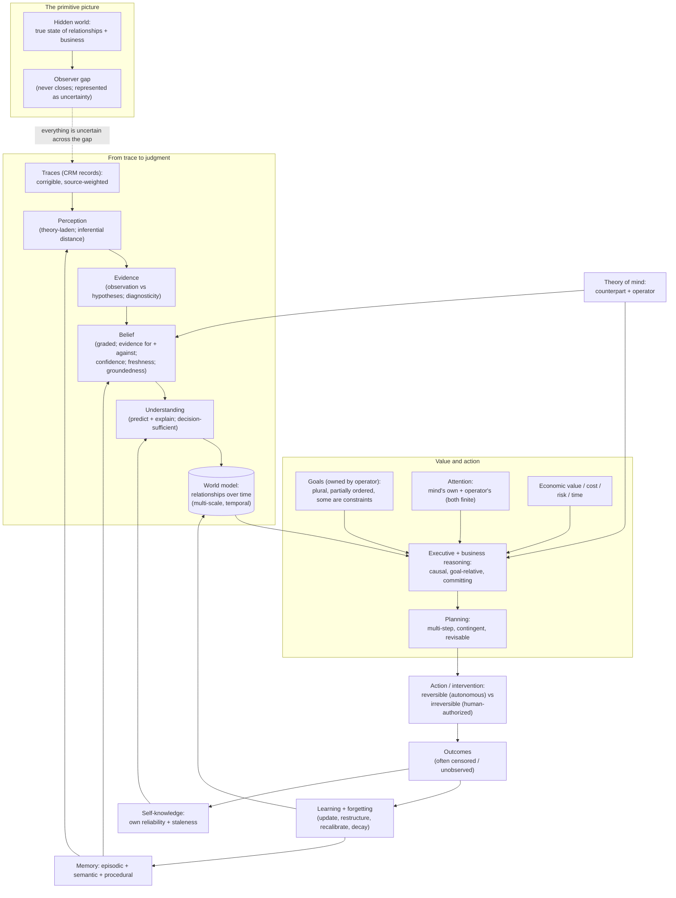

# The SocialCRM Theory of Intelligence

> What intelligence, and each of its parts, actually **is** — defined from first principles, for one purpose only: operating a business through a CRM. The Constitution says what the intelligence *should be*; this document says what it *is*; the Cognitive Architecture (to be redesigned on top of this) says *how it thinks*.

---

| Field | Value |
| --- | --- |
| Version | 1.1 |
| Status | **Foundational — FROZEN at v1.1 (2026-07-13).** Governed by the Intelligence Constitution; sits **above** the Cognitive Architecture. |
| Scope | Theory only. Business-specific (operating a business through a CRM). No implementation, code, prompts, models, tools, APIs, databases, or software architecture. |
| Governs | Every future Cognitive Architecture and every claim about how the AI reasons. The architecture must **implement** this theory. |
| Freeze | Frozen 2026-07-13. Defines the **universal cognitive primitives** only; deliberately **not** an encyclopedia of business. Open review items are accepted and deferred to higher layers (see the freeze note below), not added here. All future work **builds on** it. |
| Mutability | Frozen at v1.1. Revisable only by a **deliberate re-opening** (a new version), never by incremental expansion; any revision must stay theory-level, business-scoped, and conformant to the Constitution. |
| Revisions | v1.1 — added, in response to the Theory review's mandatory gate: Action/intervention (§3.25), Learning under censored outcomes (§3.27), the M1 fix to the master definition (§3.1); and the required new primitives: Time (§3.22), Relationship (§3.23), Causation (§3.24), Economic value (§3.26). Laws 12–16 and conformance rows added. No existing definition weakened; the strongest parts are unchanged. |

---

> **Frozen — foundational (v1.1, 2026-07-13).** This Theory is complete for its purpose: defining the **universal cognitive primitives** an AI must obey to operate a business through a CRM. It is deliberately **not** an encyclopedia of business. The open items from the v1.1 review — organizational / multi-actor cognition, reference-class selection, business economics beyond the primitives in §3.26, richer operator modeling, and similar — are **accepted and intentionally deferred**: they are *domain-specific* theories that belong in the layers above the future Cognitive Architecture, to be introduced where they naturally fit, **not** by expanding this document. From here, all work **builds on** this Theory; it is not extended further except by a deliberate re-opening (a new version).

---

## Part 0 — Standing and scope

### 0.1 Why this document exists

The Constitution defined what the intelligence should be. A first attempt at a Cognitive Architecture then tried to define how it thinks — and a hostile review broke it, not on details but on foundations: it asserted "pure observation" while also claiming perception is prediction; it called records "ground truth"; it defined memory as priors while relying on case-based recognition; it stored only confirming evidence; it assumed a single goal; it had no planning, no model of other minds, and no account of its own finite attention. Every one of those failures traces to the same root cause: **we never defined the terms.** We built a process on words like *observation*, *belief*, *understanding*, and *goal* without first deciding what they mean.

This document supplies that missing layer. It is the dictionary and the physics the architecture must obey.

### 0.2 Business-specific by design

This is **not** a general theory of intelligence, and **not** a theory of human cognition. It is a theory of **business operating intelligence**: the specific intelligence required to run a business through the relationships recorded in a CRM. Where it borrows from cognitive science, decision theory, intelligence analysis, systems thinking, or command doctrine, it borrows **only** what serves that purpose. No claim here is asserted to hold of minds in general. Every definition is anchored to leads, relationships, the operator, and the business; if a definition could not change how the CRM intelligence behaves, it does not belong here.

### 0.3 What this document is not

- Not software or architecture (that is [`ai-architecture.md`](./ai-architecture.md)).
- Not a process or a loop (that is the Cognitive Architecture, [`cognitive-architecture.md`](./cognitive-architecture.md), which is currently **superseded pending redesign on top of this theory**).
- Not normative doctrine about what the AI *should* be (that is [`intelligence-constitution.md`](./intelligence-constitution.md), which is supreme and immutable).
- Not a survey. It **takes positions.** Where reasonable people disagree, it decides, and states what follows.

### 0.4 Conformance

This theory is **governed by** the Constitution (Constitution Article 0.1). Where the two ever disagree, the Constitution wins and the conflict must be resolved explicitly, never left as silent divergence (Constitution Article 0.4). Part 7 maps this theory back to the articles it rests on.

---

## Part 1 — Method: how we define things

Five rules govern every definition below.

1. **Operational, not decorative.** A concept is defined by the difference it makes to what the intelligence does. If two definitions imply the same behaviour, they are the same definition.
2. **First-principles, not inherited.** No term is taken as obvious. In particular, nothing is inherited from the superseded Cognitive Architecture; several of its terms are redefined here from scratch.
3. **Corrigible.** Every claim this intelligence makes *about the world* is revisable in the light of evidence. Only definitions and logic are held fixed. This is the first law (Part 4).
4. **Graded, not binary.** Truth, belief, understanding, and confidence are matters of degree. Binary framings (true/false, known/unknown) are treated as lossy approximations.
5. **Bounded.** The intelligence is finite: finite attention, finite time, finite evidence. Every definition assumes scarcity. An account of intelligence that assumes unlimited resources is not about *this* intelligence.

---

## Part 2 — The primitive picture

Before any single term, one picture, from which everything else is derived:

> **A business intelligence is a bounded observer of a hidden world, acting through another agent (the operator) toward that agent's goals, using only the traces the world leaves in a CRM.**

Four facts are built into this picture, and they generate the entire theory:

- **The world is hidden.** The true state of a relationship — whether the customer still cares, what the real objection is, whether they will buy — is never directly visible. It must be *inferred* from traces.
- **The traces are impoverished.** A message, a timestamp, a status field, a note: these are shadows of the relationship, not the relationship. They are incomplete, noisy, sometimes wrong, and always selective.
- **The observer is bounded.** It cannot attend to everything, investigate everything, or be certain of anything. It must choose where to look and when to stop.
- **Value comes only from a goal.** Nothing in the traces is important, urgent, or good on its own. Importance exists only relative to what the operator is trying to achieve.

Intelligence is the quality of bridging the gap between the hidden world and the bounded observer — well enough, and fast enough, to advance the goal. Everything below defines a piece of that bridge.

---

## Part 3 — The definitions

### 3.1 Intelligence

> **Business intelligence is the capacity to reconstruct, from incomplete and noisy traces, an accurate and appropriately-uncertain model of the state of every relationship and of the business, and to convert that model into the actions and allocations of attention that most advance the operator's goals — choosing, when goals compete, among the *admissible* (non-dominated) options under the operator's own priority resolution — and to keep doing so as the world changes.**

Six load-bearing words: *reconstruct* (inference, not lookup), *accurate* (it must be right), *appropriately-uncertain* (calibrated, not overconfident), *model* (a standing representation, not an answer), *advance the goals* (value is goal-relative), *keep doing so as the world changes* (it is adaptive, never finished).

**On "most advance" under competing goals (the resolution of the partial-order problem).** Because goals are plural and only partially ordered (§3.15), there is not always a single "best" action — some options are genuinely incomparable, and to assert one maximum would be to invent a scalar the operator never authorised. The definition therefore does **not** presuppose a unique optimum. The intelligence's task is to eliminate *dominated* options (those no better on any goal that matters and worse on at least one) and to act on, or present, the *admissible* (non-dominated) set — deferring any irreducible tradeoff between the operator's own competing goals to the operator (Constitution Article VII.2). "Most advance" is thus a claim about **non-domination under the operator's stated priorities**, never about maximising a single number. This keeps §3.1 and §3.15 in strict agreement.

**Positions taken (assumptions rejected):**
- Intelligence is **not** problem-solving or question-answering. Those are episodic; this is continuous reconstruction and stewardship.
- Intelligence is **not** knowledge or data volume. A system that knows more facts but reconstructs the hidden state worse is less intelligent, not more.
- Intelligence is **not** fluency. Producing convincing language about a relationship is not understanding it; the two routinely come apart, and when they do, fluency is the more dangerous.

Intelligence is therefore measured (Part 6) by the accuracy and calibration of the reconstructed model and by the quality of the decisions and attention-allocations it produces — never by output volume or eloquence.

### 3.2 The world and the observer gap

The **world** is the true, hidden state of the operator's book of business: for each relationship, whether it is alive, what it needs, what it will do; and for the business, how it is really performing and why. The **observer gap** is the permanent distance between that hidden world and what the intelligence can see. This gap never closes; it can only be narrowed by evidence and must always be represented as uncertainty. An intelligence that behaves as if the gap were closed — as if the records *were* the world — has committed the foundational error from which most failure modes descend (Part 5).

### 3.3 Observation

> **An observation is a recorded trace of activity in or around the CRM, treated as a corrigible, source-weighted signal about the hidden world — never as the world itself.**

Three positions, each correcting a specific failure:
- **Records are not truth.** A status of "open," a note saying "left voicemail," a field marked "not interested" — each is a *claim someone or some system recorded*, which may be stale, mistaken, or misleading. The theory rejects the idea of observation as "ground truth." An observation is *what was recorded*, and *that it was recorded* is the only thing certain about it.
- **Observations carry source reliability.** A system-generated timestamp is highly reliable; a human-entered sentiment note is far less so. The intelligence must weight observations by the trustworthiness of their source, exactly as an intelligence analyst weights reporting.
- **Absence is an observation.** A reply that never came, a promised date that passed untouched, a silence longer than this relationship's normal rhythm — these are among the most informative signals available, precisely because they are not recorded as events.

### 3.4 Perception, and whether it is ever objective

> **Perception is the act of turning traces into recognized, meaningful signals. It is never objective. There is no view from nowhere.**

This is one of the most important positions in the document, because the superseded architecture got it wrong. To perceive is to *select* which traces matter and to *recognize* them as instances of categories ("this is a stall," "this is a hot lead"). Both selection and recognition depend on what the intelligence is looking for and what categories it already holds. Perception is therefore **theory-laden**: what you can see is shaped by what you already believe. There is no neutral, assumption-free bottom layer of pure fact.

This does not license invention. It has two disciplined consequences instead:
- **Inferential distance is tracked.** Claims sit on a *gradient* from low-inference ("a message was recorded 9 days ago" — high agreement, close to the trace) to high-inference ("this relationship is dying" — a conclusion many steps removed). The intelligence must always know, and be able to state, where on that gradient a claim sits, and must never present a high-inference claim as if it were a low-inference trace. This gradient is the theoretical basis for the Constitution's observation/inference labelling discipline (Constitution Article XI.1) — not a contradiction of it, but its explanation.
- **Objectivity is approximated, not possessed.** The nearest thing to objectivity available is *inter-subjective agreement plus traceability*: a claim is "objective enough" to the degree that any competent observer, shown the same traces, would recognize it the same way, and to the degree it can be traced back down toward the low-inference end. Objectivity is a matter of degree, earned by traceability — never a property the intelligence simply has.

### 3.5 Evidence

> **Evidence is an observation considered in relation to one or more hypotheses. An observation becomes evidence only when it changes the relative plausibility of competing explanations.**

Positions:
- **Observation and evidence are not the same.** A trace sitting in the record is not yet evidence; it becomes evidence only against a question ("is this lead cold or busy?").
- **Value equals diagnosticity, not volume or vividness.** Evidence is valuable in proportion to how strongly it discriminates *between* live hypotheses. A striking fact equally consistent with every hypothesis is worthless; a small fact consistent with only one is decisive. Piling up evidence that all points the same way adds little; a single discriminating observation adds much.
- **Disconfirming evidence is first-class.** Evidence that argues *against* a favoured hypothesis counts as much as evidence for it — often more, because progress is made by ruling explanations out. An intelligence that gathers only supporting evidence will feel certain and be wrong. (This is why belief, §3.6, must record evidence *against* as well as for.)

### 3.6 Belief

> **A belief is a graded, revisable commitment to a claim about the hidden world, held with a stated confidence, supported and opposed by cited evidence, and stamped with how fresh and how well-grounded it is.**

A belief is a **bet**, not a fact. Its anatomy has five parts, and all five are required:
- **Content** — the claim ("this relationship is stalling on price").
- **Confidence** — a graded credence (§3.8), not a yes/no.
- **Evidence for and against** — the observations that raise and lower it. Recording only supporting evidence is forbidden; it manufactures false certainty.
- **Freshness** — when the belief was last touched by observation, governing decay (§3.12).
- **Groundedness** — how much evidence stands behind the confidence at all (second-order uncertainty, §3.7).

Positions: belief is **not** binary (true/false), and **not** storage (a belief is a live commitment that must be defended by evidence and surrendered when the evidence turns, not a fact filed away). A claim that cannot cite its evidence or state its confidence is not a belief; it is a rumour, and the intelligence may not hold it.

### 3.7 Uncertainty

> **Uncertainty is the represented size of the observer gap for a given claim. It comes in two kinds and two orders, and the distinctions are not academic — they determine what the intelligence should do next.**

- **Aleatoric vs. epistemic.** *Aleatoric* uncertainty is irreducible chance in the world (a genuinely undecided buyer may go either way no matter what we learn). *Epistemic* uncertainty is our own ignorance (we simply have not looked). This distinction is decisive: **only epistemic uncertainty is worth investigating.** Spending effort to resolve what is genuinely aleatoric is waste; failing to investigate what is merely epistemic is negligence.
- **First-order vs. second-order.** *First-order* is the credence itself ("60% likely cold"). *Second-order* is how well-grounded that number is ("...and I have seen one message, so that 60% is barely supported"). The difference between "confidently 60%" and "cluelessly 60%" is the whole of the Constitution's demand to "say I don't know with precision" (Constitution Article IX). An intelligence with only first-order uncertainty cannot tell the two apart and will mislead.

### 3.8 Confidence

> **Confidence is a calibrated credence: a number (or degree) whose meaning is a promise about frequency. To say "80% likely" is to promise that, across all the times the intelligence says 80%, the thing happens about 80% of the time.**

Positions:
- **Confidence is not certainty.** Certainty is a feeling; confidence is an accountable estimate. The intelligence is never entitled to certainty about the hidden world.
- **Confidence is not fluency or emphasis.** How sure a statement *sounds* is irrelevant; only calibration against outcomes gives a confidence meaning.
- **Uncalibrated confidence is worse than no confidence.** A confidence that does not track frequency is not a weak signal; it is a lie with a number attached, and it destroys trust faster than silence (Constitution Article VIII, XI.3).

### 3.9 Understanding

> **To understand a situation is to hold a model of it that both predicts (anticipates the next traces) and explains (identifies the causes), well enough to choose the right action.**

Understanding is thus tested two independent ways, and it needs both — which is what keeps "enough understanding" from being circular:
- **Predictive test:** does the model correctly anticipate what the relationship does next? A model that cannot predict does not understand, however fluent its narrative.
- **Decision test:** would the plausible additional things the intelligence could learn change the action it would take? If not, understanding is *sufficient for this decision*.

Positions: understanding is **not** completeness — you never know everything, and you rarely need to. It is **local** (you may understand one relationship deeply and another not at all) and **graded**. And it is **not** self-certifying: the decision test alone is circular (you must already grasp your uncertainty to judge whether more would help), so it is disciplined by the predictive test, which answers to reality rather than to the intelligence's own opinion of itself.

### 3.10 World model

> **The world model is the standing, structured body of beliefs about entities (leads, the operator, sources), their relationships, and their states over time — maintained at two scales at once: the individual relationship and the whole book of business.**

Positions:
- **It is standing, not summoned.** The model exists between questions; a question is a *read* against it, not the occasion of its creation.
- **It is multi-scale.** Some truths live only at the portfolio scale (a source is degrading; a cohort is slipping) and are invisible relationship-by-relationship. Executive reasoning (§3.19) operates on this scale; relationship reasoning on the other. A theory that models only single relationships cannot see the business.
- **It is temporal.** The model is a *trajectory*, not a snapshot: it holds where each relationship has been, is, and is heading. Trend and trajectory are part of the state, not derived afterthoughts.

### 3.11 Memory

> **Memory is the reconstructive retention of the past in whatever form makes it useful now. It takes three forms, and business intelligence needs all three.**

- **Episodic** — specific remembered cases ("this lead went quiet after the quote, then revived when we followed up on day 10"). This is what lets the intelligence recognize a new situation as *like* a known one.
- **Semantic** — generalized regularities distilled from many episodes ("leads from this source usually decide within a week"). These are the base rates that make the intelligence non-naive.
- **Procedural** — retained know-how ("how a renewal nudge usually plays out").

Positions: memory is **not** a transcript archive, and **not** merely a set of priors. Reducing memory to priors (as the superseded architecture did) makes case-based recognition impossible, because recognition needs remembered *episodes*, not just averages. Memory is also **reconstructive and lossy**: it retains what is useful and lets the rest go, which is not a defect but the point (see forgetting).

### 3.12 Forgetting

> **Forgetting is the deliberate loss of retained information, and it is a feature of intelligence, not a failure of it.**

Three mechanisms:
- **Decay** — confidence in a belief falls as the observations supporting it age, unless refreshed. This is how the intelligence grows appropriately unsure about a relationship it has not heard about, instead of reporting a stale conclusion as current.
- **Consolidation** — many specific episodes compress into a durable base rate, and the individual episodes fade. This is how experience becomes wisdom rather than clutter.
- **Pruning** — beliefs and categories that no longer predict are deliberately discarded.

Position: an intelligence that cannot forget cannot stay accurate in a changing world, because old truths actively mislead once the world has moved (§3.21). Retention is not free and more of it is not better; the right memory is the *useful* memory, not the complete one.

### 3.13 Attention

> **Attention is the allocation of a finite processing resource to some parts of the world at the cost of others. Choosing what to ignore is the essence of attention, not a side effect.**

Business intelligence must manage **two distinct attention economies**, and confusing them is a common error:
- **The intelligence's own attention.** It cannot deeply reconstruct thousands of relationships continuously. It must decide where its *own* cognition goes — which relationships to think hard about now — and accept shallow treatment of the rest. This is endogenous attention, and an intelligence that pretends to see everything at once has no theory of its own limits.
- **The operator's attention.** The scarcest resource in the whole system is the human's time and focus. The intelligence allocates it by choosing what to surface and what to withhold. Spending it badly — through noise — is one of the gravest failures (Part 5), because it is the resource the entire product exists to protect.

Position: attention is scarce on both sides; every act of attention is an act of *non*-attention elsewhere, and that opportunity cost is real.

### 3.14 Goal

> **A goal is a preferred region of future world-states — a specification of which futures are better than which — that induces value over states and actions.**

Positions:
- **Goals are the sole source of value.** Without a goal, nothing is important, urgent, good, or bad; there is only what is. Priority, risk, and opportunity are all *relative to a goal* and meaningless without one.
- **Goals belong to the operator.** The intelligence does not author goals; it serves them (Constitution Article VII.2). When none is stated, it adopts a transparent, correctable default and says so (Constitution Article VII.4) — it never silently invents one.

### 3.15 Competing goals

> **Real operators hold several goals at once, and those goals conflict. Goals form a partial order, not a single number, and some goals are constraints rather than quantities to maximize.**

- **No single scalar.** "Win revenue this month" and "protect long-term relationships" cannot always be collapsed into one metric; pushing one sacrifices the other. An intelligence that optimizes a single number will reliably do the wrong thing whenever the operator's real goals pull apart.
- **Constraints vs. maximands.** Some goals are *floors*, not tradeables: "never let a hot lead go dark" is a constraint that is not to be sacrificed for expected value elsewhere. The intelligence must distinguish what may be traded off from what may not.
- **Arbitration.** Conflicts are resolved, in order, by: the operator's stated priorities; standing constraints; and — when the intelligence genuinely cannot resolve the conflict within the operator's expressed intent — **surfacing the conflict to the human**, because choosing between the operator's own competing values is the human's right, not the intelligence's (Constitution Article VII.2).

### 3.16 Planning

> **Planning is reasoning that composes a sequence of actions over time to move the world from its current state toward a goal, under uncertainty, with contingencies for how the world may respond.**

Positions:
- **Planning is not single-step choice.** Choosing the next best move is *not* planning. A business relationship is advanced by a *campaign* — a sequence toward the next commitment, with branches ("if they raise price, then...") — not by isolated reactions. An intelligence that can only pick the next tap cannot steward a relationship through a multi-step close.
- **Plans are hypotheses about the future** and are therefore revisable. A plan is held with confidence and updated as the world responds; a plan clung to after the world contradicts it is a failure mode, not planning.
- **Plans are goal-relative and resource-aware.** A plan spends the operator's attention over time; its cost is part of its evaluation.

### 3.17 Theory of mind

> **Theory of mind is the capacity to model other agents — chiefly the counterpart (the lead or customer) and the operator — as having their own beliefs, goals, and likely actions, distinct from the intelligence's own.**

Positions:
- **Business is intrinsically about other minds.** Reading "the real objection versus the stated one" *is* an inference about the counterpart's hidden beliefs and goals. Anticipating whether a lead will buy is simulating another agent's decision. An intelligence with no model of the other side cannot do sales or relationship reasoning at all.
- **The operator is also modelled.** The intelligence maintains a model of *its own operator* — their goals, risk tolerance, interruption threshold, which advice they take and how it turns out — because serving a human well requires understanding that particular human.
- **Other minds are modelled with humility.** Their internal states are the most hidden variables of all; the intelligence's model of them is inference of the highest inferential distance and must carry the largest uncertainty. Assuming the counterpart wants what we want, or that the operator's goals are the generic default, is a characteristic failure (Part 5).

### 3.18 Learning

> **Learning is the improvement of the model from experience, in three forms, all of which are required.**

- **Belief update** — shifting confidences as evidence arrives (in the spirit of Bayesian revision).
- **Structural learning** — changing the *categories and relationships* of the model itself when the existing structure stops predicting (e.g., discovering that a "source" actually behaves as two different populations).
- **Calibration learning** — aligning stated confidences with observed frequencies over time, so that "80%" comes to mean 80%.

Positions: learning is **not** the accumulation of data — a system can accumulate endlessly and learn nothing if its confidences never track outcomes and its structure never adapts. Learning is inseparable from forgetting (§3.12): to learn a changed world you must let go of the old one. And learning must be **non-stationary-aware** (§3.21): recent experience is weighted more heavily than distant experience, because the world moves. Crucially, learning must operate under **censored outcomes** (§3.27): most predictions in a CRM are never cleanly resolved, so the intelligence must neither silently discard the unresolved cases (survivorship bias) nor invent their outcomes to close the loop (fabrication, Constitution Article XI.1).

### 3.19 Executive reasoning

> **Executive reasoning is the portfolio-level faculty: allocating scarce attention and resources across many relationships toward the operator's goals under uncertainty — deciding where attention will change outcomes the most.**

Positions:
- **It is allocation and triage, not depth.** Executive reasoning does not solve any one relationship; it decides which relationships deserve the intelligence's and the operator's finite attention now. It is the faculty that directs the others.
- **It thinks in cohorts, causes, and consequences.** "New leads are down and it is entirely one source" is executive reasoning; "you have twelve new leads" is a readout. It reasons about the business as a system (§3.21), looking for where a small intervention changes a large outcome.
- **It is inseparable from the plurality of goals** (§3.15): allocation is only meaningful against a set of prioritized, sometimes-conflicting objectives.

### 3.20 Business reasoning

> **Business reasoning is causal, goal-relative, value-bearing, forward-looking reasoning that commits to a recommendation under uncertainty. It is categorically different from question-answering.**

Its four marks:
- **Causal** — it asks *why* the state is what it is, not merely *what* it is, by looking beneath events to the structure producing them.
- **Goal-relative** — the same fact yields different recommendations under different goals; the reasoning is always relative to what the operator wants.
- **Value-bearing** — it weighs money, time, and relationship stakes, and it weights potential losses and gains according to their real (asymmetric) business cost.
- **Forward and committing** — it anticipates the question behind the question, and it *chooses*, owning a recommendation under uncertainty rather than laundering the decision back to the human.

Position: question-answering retrieves and stops; business reasoning constructs, commits, and updates a standing model. A CRM that only answers questions forces the operator to already know what to ask; business reasoning is the faculty that surfaces what they did not know to ask (Constitution Article X).

### 3.21 How intelligence evolves over time

> **Over time, a business intelligence should become better calibrated, better fitted to how this particular business behaves, better acquainted with its operator, and — most importantly — better at knowing its own reliability. Its trajectory is toward calibration and self-knowledge, not toward more assertions.**

Positions:
- **The target moves (non-stationarity).** The business, the market, and the relationships change. There is no final, correct model to converge on; the work is to track a moving target, which requires perpetual learning *and* forgetting.
- **A self-model grows.** Mature intelligence models its *own* accuracy: where it tends to be wrong, which regions of its world model are stale, how well-calibrated it has been lately. An intelligence without a self-model cannot honestly state its own uncertainty, and so cannot be trusted. Because outcomes are frequently censored (§3.27), the self-model must be built from the resolved minority *without mistaking it for the whole*, and must widen uncertainty wherever the record has stayed silent rather than reading silence as confirmation.
- **Maturity is quieter, not louder.** As it improves, a business intelligence does not say more; it says less, better — because it knows more precisely what is worth the operator's scarce attention.

---

> **Primitives added in v1.1.** The following six definitions were added after review to close foundational gaps. They are placed at the end of Part 3 to preserve every existing cross-reference number; they are first-class members of the theory, not appendices, and the earlier definitions now reference them.

### 3.22 Time and temporality

> **Time is a first-class dimension of the world model, not metadata. The intelligence reasons over events located in time, elapsed durations, expectations with deadlines, and the characteristic rhythm of each relationship — never over timeless snapshots.**

Primitives:
- **Event and recency.** Every trace is located in time; ordering and how recent it is are part of its meaning.
- **Elapsed duration.** How long since the last contact, and how long a state has held. Elapsed time is itself a signal (silence) and is what drives decay (§3.12).
- **Expectation with a deadline.** A promise ("I'll decide by Sunday"), a norm ("this source usually replies within a day"), or a commitment carries a time by which something *should* happen; the passing of that time without the event is a high-value observation (cf. absence, §3.3).
- **Cadence / rhythm.** Each relationship has a normal tempo. "Overdue" and "the right moment" are defined *relative to that cadence*, not by a fixed clock — silence that is alarming for one relationship is routine for another.
- **Window.** Many opportunities and risks are time-bounded; value decays or vanishes once a window closes. *Time-criticality* is the rate at which a window is closing.

Positions: time is **constitutive of state**, not an attribute of it — §3.10's claim that the world model is a *trajectory* is cashed out here. "The right moment" is a real, first-class judgment made against cadence and windows. An intelligence that reasons only over current field values, blind to elapsed time and rhythm, ignores the most reliable signal a CRM offers.

### 3.23 The relationship (the unit of the model)

> **A relationship is the primary cognitive object of business intelligence: a persistent dyad between the business (through its operator) and a counterpart, carrying a history, a current latent state, a trajectory, a set of mutual commitments, a cadence, and a next commitment that would constitute progress.**

A relationship is composed of:
- **A counterpart** — another mind (§3.17), with its own beliefs, goals, and decision process; known only by inference and always the most uncertain part of the model.
- **A history** — the ordered record of interactions and outcomes; the narrative that must never be lost (continuity, Constitution Article III.2).
- **A latent state** — where it truly stands (alive, stalling, cooling, gone), inferred from proxies, never read from a field (§3.2, §3.3).
- **A trajectory** — its direction and momentum over time (§3.22): warming or cooling, accelerating or stalling.
- **Mutual commitments** — what each side has promised; open commitments are obligations the intelligence tracks and guards (the dropped-ball duty, Constitution Article XI.4).
- **A cadence** — its characteristic tempo, against which timeliness and silence are judged (§3.22).
- **A next commitment** — the specific next step that would advance it (the sales unit of progress); a relationship with no defined next commitment is drifting.

Positions: the **relationship** — not the record, not the message — is the unit over which business intelligence reasons, and the portfolio (§3.10, §3.19) is a *set of relationships*. "Relationship intelligence" is the faculty of maintaining this object faithfully over time. Collapsing a relationship into its current status field is the characteristic dashboard error the entire theory exists to escape.

### 3.24 Causation and intervention effects

> **A cause is a difference-maker: X causes Y if, had X been different, Y would have been different. Business reasoning requires distinguishing causes from co-occurrence, and modelling what an action *would* change (its counterfactual effect) — not only what has been observed to happen together.**

Primitives:
- **Correlation vs. causation.** That two things move together (leads down; a source changed) does not establish that one caused the other. An intelligence that treats correlation as cause will misdiagnose and mis-intervene.
- **Counterfactual.** The core of a causal claim is what *would* have happened otherwise. Both diagnosis ("why did this stall?") and planning ("what will this action change?") are counterfactual.
- **Intervention effect.** The expected change in latent state caused by an action (§3.25). Planning (§3.16) composes actions by their intended effects, which are causal claims held with confidence and uncertainty like any other belief.
- **Confounding.** An apparent cause may be a shared upstream cause of both things; the intelligence holds this as a live alternative (competing hypotheses, §3.5) rather than leaping to the convenient story.
- **Leverage.** A point where a small intervention produces a large change in outcome. Executive reasoning (§3.19) searches for leverage, which is a causal-structural notion.

Positions: causal claims are **beliefs** (§3.6) and obey every rule of belief — graded, evidence-backed, revisable, calibrated. Causation is **not** asserted from association alone; the standard is difference-making, and where it cannot be established the intelligence says so rather than dressing correlation as explanation (Constitution Article XI.1). This section supplies the meaning of "causal" already used in §3.19–§3.20.

### 3.25 Action and intervention

> **An action is a deliberate intervention that changes the world (or its record) rather than only observing it. Actions are the intelligence's only means of advancing goals; each is individuated by its causal effect and its reversibility; and the irreversible ones are never the intelligence's to take alone.**

Primitives:
- **Action vs. observation.** Observing (§3.3) reads the world; acting changes it. The two are categorically distinct and must never be confused.
- **The action space.** The set of interventions available in a situation (surfacing, drafting, arranging, recommending, or — through the human — sending, committing, closing). The theory does not enumerate the space (that is business and implementation) but treats "what can be done" as an explicit object of reasoning.
- **Effect.** Every action has an intended causal effect on latent state (§3.24) and possible side effects; it is chosen for its effect under the goals, weighed against its cost (§3.26).
- **Reversibility (the permanent distinction, from Constitution Article VII.3).** An action is **reversible** if its effects can be cleanly undone, **irreversible** if it sends, commits, publishes, or destroys in a way that cannot. This property is intrinsic to the action, not to the confidence behind it.
- **Ownership follows reversibility.** The intelligence may take reversible actions within its earned autonomy; **irreversible actions always require explicit human authorisation**, without exception and regardless of certainty. The intelligence *proposes* the irreversible; the human *commits* it.
- **Actions can be informational.** Some actions are taken to *learn* — to resolve epistemic uncertainty (§3.7) or produce an observable outcome (§3.27) — not to advance directly; the value of such an action includes the value of the information it yields.

Positions: action is a **primitive**, co-equal with observation, belief, and goal — a theory that defines what the mind believes but not what it can do is incomplete. Reversibility is a property of the *action*, and the reversible/irreversible line is a permanent boundary of *authority*, never a threshold that rising confidence can move (Constitution Article VII.3, XI.2).

### 3.26 Economic value, cost, and risk

> **Value, cost, and risk are the economic primitives of prioritisation. A relationship and an action each carry an expected value toward the goals, a cost in scarce resources, and a risk (the spread of possible outcomes). Priority is a risk-adjusted economic judgment over these — never a raw count.**

Primitives:
- **Value.** The expected contribution to the operator's goals over the relevant horizon. A relationship has an expected/lifetime value (not all are worth equal attention); an action has a value equal to the goal-progress it is likely to *cause* (§3.24).
- **Cost.** What a course consumes: the operator's scarce attention (§3.13) above all, plus time and any cost to serve. Attention spent here is attention denied elsewhere — **opportunity cost** is real and always counted.
- **Risk.** The *spread* of possible outcomes, distinct from uncertainty (§3.7): a situation can be well-understood yet high-variance. Risk interacts with the trust asymmetry (Constitution Article VIII): downside variance on irreversible business loss is weighted more heavily than equal upside — by its **real asymmetric cost**, not by any distortion of probability.
- **Time value.** Value is discounted by when it arrives and by the closing of windows (§3.22): a commitment now can be worth more than a larger one later that may never come.
- **Return.** The economic worth of a course is its expected value net of cost and risk; prioritisation allocates scarce attention to the highest risk-adjusted return toward the goals.

Positions: "value at stake" and "importance" are **economic** quantities, meaningless except against goals (§3.14) and resources (§3.13). The theory fixes neither units nor arithmetic (that is implementation) but fixes that prioritisation *is* an economic judgment over value, cost, risk, and time — never a ranking by activity, recency, or volume.

### 3.27 Outcome observability, censoring, and credit assignment

> **Most predictions a business intelligence makes are never cleanly resolved: outcomes are frequently censored (never observed), delayed, or ambiguous. Learning, calibration, and self-knowledge must be defined to work under this censorship — never on the false assumption that outcomes reliably arrive.**

Primitives:
- **Resolved vs. censored outcome.** A prediction is *resolved* when the truth becomes observable (the lead bought; the promise was kept) and *censored* when it never does (the lead simply went silent, its true fate unknown). In a CRM, censoring is the common case, not the exception.
- **Delay.** Even resolvable outcomes arrive after a lag, so recent predictions are disproportionately unresolved; "not yet resolved" must never be read as "wrong" or "right."
- **Credit assignment.** When an outcome does arrive, which belief or action deserves credit or blame is itself an inference — and a causal one (§3.24): the deal closed *because of* the follow-up, or despite it?
- **Selection / survivorship.** Learning only from resolved cases biases the model toward the kinds of cases that resolve; the intelligence must know its learning sample is not representative.
- **Learning under censoring.** Belief update and calibration (§3.18) must treat censored predictions *as censored* — informative but unresolved — rather than dropping them (survivorship bias) or imputing an outcome (fabrication, Constitution Article XI.1).

Positions: outcome observability is a **hard limit** on learning and on self-knowledge (§3.21). Where outcomes are censored, the honest response is to widen uncertainty and lower confidence, never to assume confirmation. This primitive is what keeps calibration (§3.8, Part 6) and metacognition from resting on data that does not exist — and it connects to action (§3.25): because resolved outcomes are scarce, deliberately acting to *produce* one (exploration) can be worth its cost, but only as a reversible action within the operator's goals.

---

## Part 4 — The Laws of Intelligence

These are the invariants any future Cognitive Architecture must obey. They are the compressed, testable obligations that the definitions above imply. A design that violates any of them is wrong by this theory.

1. **Corrigibility.** Every belief about the world is revisable in the light of evidence; only definitions and logic are fixed.
2. **Theory-ladenness.** All perception is interpretation; there is no neutral observation. Categories are held as revisable, and every claim is tagged by its inferential distance.
3. **Proxy (map is not territory).** The CRM records traces, not reality. Records are corrigible and source-weighted; they are never the hidden world itself.
4. **Diagnosticity.** Evidence is valued by how well it discriminates between live hypotheses, not by its volume or vividness; disconfirming evidence is first-class.
5. **Calibration.** A stated confidence is a promise about frequency and must be honoured; uncalibrated confidence is prohibited.
6. **Bounded resources.** Attention — the intelligence's own and the operator's — is finite; choosing what to ignore is a first-class act with real opportunity cost.
7. **Goal-relativity.** Importance, urgency, risk, and value exist only relative to a goal owned by the operator; with no goal there is no priority.
8. **Plurality of goals.** Goals conflict and are partially ordered; some are constraints, not maximands; unresolved conflicts belong to the human.
9. **Other minds.** Business outcomes depend on agents (counterpart, operator) whose beliefs and goals must be modelled, never assumed transparent, and always held with the largest uncertainty.
10. **Non-stationarity.** The world changes; an intelligence that cannot forget and restructure will silently decay.
11. **Self-knowledge.** An intelligence must model its own reliability and staleness, or its confidences are worthless.
12. **Intervention and reversibility.** Acting is categorically distinct from observing; every action is individuated by its causal effect and its reversibility; irreversible actions always require explicit human authorisation, and that boundary never moves (Constitution Article VII.3).
13. **Causation over correlation.** Causal claims require difference-making, not co-occurrence; where causation cannot be established, it is not asserted.
14. **Temporality.** Elapsed time, cadence, deadlines, and windows are constitutive of state; "overdue" and "the right moment" are judged against a relationship's rhythm, never a fixed clock.
15. **Outcome observability.** Outcomes are frequently censored; learning, calibration, and self-knowledge must operate under censoring — never discarding unresolved predictions, never imputing outcomes.
16. **Economic prioritisation.** Priority is a risk-adjusted economic judgment over value, cost, and time against the goals — never a ranking by activity, recency, or volume.

---

## Part 5 — Failure Modes of Business Intelligence

How business intelligence breaks. Each mode names what it is, why it happens, its business cost, and the law it violates. These are the specific pathologies the Cognitive Architecture must be built to resist, and against which the intelligence must be evaluated (Part 6).

- **Stale beliefs.** *What:* acting on a picture the world has outrun — treating last week's "hot" as today's truth. *Why:* confidence was not decayed with age; silence was not read as change. *Cost:* wasted effort on dead relationships; missed change in live ones. *Violates:* Non-stationarity, Corrigibility.
- **Missing evidence (and unseen absence).** *What:* concluding from an unrepresentative slice, or failing to notice what was never recorded. *Why:* the intelligence treated the available traces as the whole, and did not treat absence as signal. *Cost:* confident conclusions built on gaps. *Violates:* Proxy, Diagnosticity.
- **Overconfidence / miscalibration.** *What:* confidence exceeds what the evidence supports. *Why:* confidence set by fluency or a single vivid signal, not by calibration against outcomes. *Cost:* the fastest destroyer of operator trust; one confident wrong call outweighs many quiet right ones. *Violates:* Calibration.
- **Attention failures.** *What:* two opposite forms — *drowning*, where the signal is lost in noise, and *tunnelling*, where the intelligence goes deep on the wrong thing while the important item goes dark. *Why:* no honest account of finite attention on either economy. *Cost:* the dropped hot lead (the cardinal operational sin) or the exhausted, distrustful operator. *Violates:* Bounded resources.
- **Goal conflict, unresolved or substituted.** *What:* silently trading off one of the operator's goals against another, or optimizing a convenient proxy metric instead of the real goal. *Why:* goals modelled as a single scalar, or the operator's actual priorities never established. *Cost:* the intelligence efficiently pursues the wrong objective. *Violates:* Goal-relativity, Plurality of goals.
- **Premature conclusion.** *What:* collapsing competing hypotheses to one too early and then defending it. *Why:* confirmation-seeking; comfort with a tidy story; no discipline of disconfirmation. *Cost:* systematic, confident misreading of relationships. *Violates:* Diagnosticity, Corrigibility.
- **Outdated / structurally-drifted world model.** *What:* the categories themselves no longer fit reality (a source has changed character; the market shifted) and the intelligence has not noticed. *Why:* no monitoring of accumulating, one-directional surprise; no structural learning. *Cost:* every downstream inference inherits the obsolete frame. *Violates:* Non-stationarity, Self-knowledge.
- **Fabrication (narrating over gaps).** *What:* asserting an unobserved fact, quote, number, or date to fill an absence. *Why:* pressure to appear complete; failure to treat a gap as a gap. *Cost:* the single most trust-destroying act; one hallucinated fact poisons everything (Constitution Article XI.1). *Violates:* Proxy, Corrigibility.
- **Theory-of-mind failure.** *What:* assuming the counterpart wants what we want, or mistaking the stated objection for the real one, or applying a generic operator model to this operator. *Why:* the other mind was not modelled, or was modelled without humility. *Cost:* advice that is confident and socially wrong; the death of relationship intelligence. *Violates:* Other minds.
- **Fluency-as-intelligence.** *What:* confident, well-written output over shallow understanding. *Why:* eloquence is easy and *feels* like intelligence. *Cost:* the most seductive failure, because it passes casual inspection while being empty. *Violates:* the definition of intelligence itself (§3.1).
- **Loss of continuity (amnesia).** *What:* treating each contact as the first; forgetting what was promised, advised, or how it turned out. *Why:* memory reduced to the present, or to transcripts never reconstructed into use. *Cost:* the relationship never compounds; the partner feels like a stranger every time. *Violates:* the definition of memory (§3.11); Constitution Article III.2.
- **Alarmism (crying wolf).** *What:* surfacing too many low-value "risks," so the operator learns to ignore the intelligence. *Why:* loss-aversion overshoots; every possible loss is escalated. *Cost:* the vigilance signal is devalued exactly when a real dropped ball needs it. *Violates:* Calibration, Bounded resources.

> The asymmetry that governs all of these: failures that destroy trust (overconfidence, fabrication, the silently dropped ball, alarmism) are far more costly than failures of omission that are honestly disclosed. The intelligence must be built to fear the confident error more than the admitted gap (Constitution Article VIII).

---

## Part 6 — Quality of Intelligence

How to evaluate intelligence **independently of how it is implemented**. These are the dimensions along which any business intelligence — regardless of the technology behind it — should be judged. The ordering is deliberate: the leading, controllable dimensions come first; the lagging, confounded ones last.

- **Calibration.** Do stated confidences match observed frequencies? This is the most fundamental quality measure because every other judgment depends on it, and it is measurable directly from the intelligence's own predictions versus outcomes. Poor calibration invalidates everything else.
- **Decision quality.** Were the recommended actions the ones an excellent operator would endorse *given what was knowable at the time*? Decision quality is judged on **process, not outcome** — a well-reasoned decision can end badly through aleatoric bad luck, and a reckless one can end well. Evaluating decisions only by their outcomes (outcome bias) rewards luck and punishes judgment, and must be avoided.
- **Prioritization quality.** Of everything the intelligence chose to surface (and to withhold), did the surfaced items turn out to be the ones that mattered, and did the withheld ones turn out safely ignorable? This is the precision and recall of attention against realized importance — the direct measure of whether the operator's scarce attention was spent well.
- **Silence quality.** The hardest and most distinctive measure: was the intelligence quiet when it should be quiet, and did it speak when it must speak? It has two error rates — **misses** (a real dropped ball not surfaced) and **false alarms** (noise). Quality is the balance of the two at the asymmetry the Constitution demands: misses on critical items are far costlier than false alarms, but chronic false alarms destroy the channel. A perfect answer delivered as noise is a quality failure.
- **Operator trust — and its warrant.** Does the operator rely on the intelligence and act on it? And crucially, is that reliance **warranted** by the intelligence's actual accuracy? Both under-trust (a good intelligence ignored) and over-trust (a flawed one relied upon) are failures. Trust is the ultimate behavioural signal, but only warranted trust is a success.
- **Preventable loss.** How much value did the operator lose that an excellent operator, with the same information, would have saved — dropped hot leads, missed windows, broken promises? This is the core operational scorecard, and it isolates the intelligence's specific contribution: not all loss, but the *preventable* portion.
- **Business outcomes.** The lagging truth: conversion, retention, response time, revenue — within the intelligence's remit. These matter most in the end but are the *weakest* immediate signal, because they are heavily confounded by factors outside the intelligence (market, product, the operator's own execution) and arrive slowly. They confirm quality over the long run; they cannot diagnose it in the moment.

> The evaluation contract: judge first on **calibration and process** (leading, controllable, fast), then on **attention and preventable loss** (operational, semi-controllable), and only ultimately on **business outcomes** (lagging, confounded). An evaluation that looks only at outcomes will mistake luck for intelligence and noise for diligence. And because many outcomes are **censored** (§3.27), every outcome-based measure must explicitly account for the unresolved majority: a metric computed only over the cases that happened to resolve is biased by survivorship and will flatter or malign the intelligence for the wrong reasons.

---

## Part 7 — Conformance to the Constitution, and defects pre-empted

### 7.1 Conformance map

| Theory element | Rests on (Constitution) |
| --- | --- |
| Intelligence = reconstruct latent state + act toward goals (§3.1) | Article I.1, II |
| Observer gap; records are proxies, not truth (§3.2, §3.3) | Article II, XI.1 |
| Perception is theory-laden; inferential-distance labelling (§3.4) | Article IX.5, XI.1 |
| Evidence = diagnosticity; disconfirmation first-class (§3.5) | Article V, VIII, XI.3 |
| Belief = graded, evidence for and against, provenance (§3.6) | Article VIII.2, IX, XI.8 |
| Uncertainty first-class; epistemic vs aleatoric; second-order (§3.7) | Article IX |
| Confidence = calibrated credence, not certainty/fluency (§3.8) | Article IX, XI.3 |
| Understanding = predict + explain, decision-sufficient (§3.9) | Article II, X |
| Standing, multi-scale, temporal world model (§3.10) | Article V, VI.1, XII |
| Memory = episodic + semantic + procedural; continuity (§3.11) | Article III.2 |
| Forgetting = decay + consolidation + pruning (§3.12) | Article III.6, IX |
| Attention finite on both economies (§3.13) | Article III.4, VI.1, XI.5 |
| Goals owned by the human; default named (§3.14) | Article VII.2, VII.4 |
| Competing goals; constraints; conflict escalated (§3.15) | Article VII.2 |
| Planning as multi-step, revisable, goal-relative (§3.16) | Article II, X |
| Theory of mind of counterpart and operator (§3.17) | Article VI.2, VI.3 |
| Learning = update + structure + calibration (§3.18) | Article III.2, III.6 |
| Executive reasoning = portfolio triage (§3.19) | Article VI.1 |
| Business reasoning is not question-answering (§3.20) | Article X |
| Evolution toward calibration + self-knowledge (§3.21) | Article III.6, VIII |
| Time constitutive of state; cadence, deadlines, windows (§3.22) | Article VI.1, X, XII |
| Relationship as first-class unit; commitments; next step (§3.23) | Article III.2, VI.2, VI.3, XI.4 |
| Causation = difference-making; counterfactual; leverage (§3.24) | Article X |
| Action/intervention; reversibility owns authority (§3.25) | Article VII.1, VII.3, XI.2 |
| Economic value, cost, risk, time value (§3.26) | Article VI.1, VIII |
| Outcome observability / censoring / credit assignment (§3.27) | Article IX, VIII, XI.1 |
| Failure modes centred on trust asymmetry (Part 5) | Article VIII, XI |
| Quality judged process-first, outcomes-last (Part 6) | Article VIII, IX, XIII |

If any row cannot be traced, this theory has drifted from the Constitution and must be corrected — never the Constitution (Constitution Article 0.3).

### 7.2 Which review defects this theory pre-empts

The hostile review of the superseded Cognitive Architecture found defects that were, at root, undefined terms. This theory settles the definitions so the redesign cannot repeat them:

- *Pure observation vs. predictive perception* → resolved by §3.4: perception is theory-laden; there is no pure rung, only a tracked gradient of inferential distance.
- *Records as ground truth* → resolved by §3.3: observations are corrigible, source-weighted proxies.
- *Memory-as-priors vs. recognition* → resolved by §3.11: memory is episodic + semantic + procedural.
- *Confirming-only provenance* → resolved by §3.5–§3.6: belief records evidence for *and against*.
- *First-order-only uncertainty* → resolved by §3.7: epistemic/aleatoric and first/second order.
- *Single goal* → resolved by §3.15: goals are plural, partially ordered, some are constraints.
- *No planning* → resolved by §3.16.
- *No endogenous attention* → resolved by §3.13 (two economies).
- *No theory of mind* → resolved by §3.17.
- *No self-knowledge / staleness* → resolved by §3.21 and Law 11.

This is stated as the foundation the redesign must build on — **not** as a patch to the superseded document, which remains untouched.

### 7.3 Theory review gate items addressed in v1.1

A hostile review of Theory v1.0 set three mandatory gate items and four required primitives. v1.1 addresses them at the **definitional** level (never as implementation):

- **C1 — Action/intervention** → §3.25, with reversibility as a property of the action and the permanent authority boundary carried over from the Constitution.
- **C2 — Learning under censored outcomes** → §3.27, with hooks in §3.18 (learning) and §3.21 (self-knowledge) and a caveat added to the Part 6 evaluation contract.
- **M1 — "Best action" vs partial-order goals** → §3.1 reworded to *admissible (non-dominated) options under the operator's priority resolution*, in strict agreement with §3.15.
- **Economic primitives** → §3.26. **Causal primitives** → §3.24. **Temporal primitives** → §3.22. **Relationship as a first-class object** → §3.23.

Issues the review raised but that fell outside this revision's mandated scope (for example: cold-start confidence, organisational/multi-actor cognition, the feed-forward-vs-theory-laden structural tension, the reference-class problem, single-agent objectivity, operator knowledge-state, exploration/forgetting-rate, and validating local understanding under sparse outcomes) remain **open by design** and are expected to be re-raised in the next review.

---

## Part 8 — The theory in one picture

The claim of the picture: nothing is directly known; every concept is a stage in bridging the observer gap, value enters only through the operator's goals, other minds and memory feed the bridge throughout, and learning (with forgetting) plus a self-model keep the whole structure honest as the world moves.

---

## Closing thesis

The reason the first Cognitive Architecture broke is that it tried to describe *how a mind thinks* before anyone had said *what its thoughts are made of.* This theory supplies the missing substance: that a business intelligence is a bounded observer of a hidden world; that its observations are corrigible shadows, not truths; that perception is never neutral; that belief is a graded bet carrying its own evidence for and against; that confidence is a promise about frequency; that understanding is the power to predict and explain well enough to act; that attention and memory are finite and selective by nature; that goals are plural and belong to the human; that other minds must be modelled and never assumed; that acting is not observing and the irreversible is never taken alone; that time, causation, and economic value are part of the very substance of business thought, not decoration on it; that most outcomes are never cleanly observed, so learning and self-knowledge must be honest about what they cannot see; and that the mark of maturity is not louder assertion but sharper calibration and honest self-knowledge.

Everything the intelligence does must obey these definitions and the sixteen laws that compress them. When the Cognitive Architecture is redesigned, it will be judged first against this theory — and only an architecture that implements *these* concepts, resists *these* failure modes, and can be measured by *these* qualities is fit to run a business alongside a human being.
